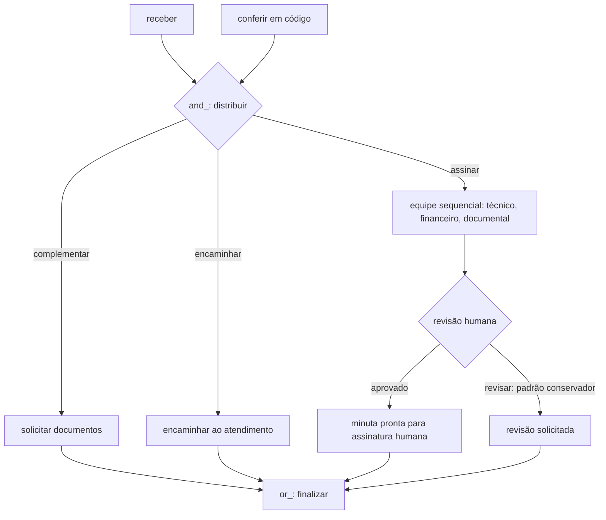

# Aula 05 — Mini LAB de orquestração

Cenário didático: triagem de demandas de TI da SEFAZ-MT. As seis manifestações
são **fictícias**, conforme a opção escolhida para esta preparação. Não representam
relatos recebidos pelo órgão. Para cumprir literalmente o item 1, substitua-as
por seis manifestações reais anonimizadas e fixe novamente o gabarito antes de executar.

O laboratório anterior e suas evidências continuam em `aula04/`.

## Executar

Da raiz do repositório, usando o ambiente próprio da aula05:

```bash
aula05/.venv/bin/python aula05/minilab.py testar
aula05/.venv/bin/python aula05/minilab.py hierarquia
aula05/.venv/bin/python aula05/minilab.py fluxo --cenario incompleta
aula05/.venv/bin/python aula05/minilab.py fluxo --cenario simples
aula05/.venv/bin/python aula05/minilab.py fluxo --cenario complexa
```

Para instalar separadamente: crie um ambiente Python 3.12 e instale
`aula05/requirements.txt`. Configure `OPENAI_API_KEY` e `MINILAB_MODELO` em
`aula05/.env`. O programa usa somente a configuração desta aula e as variáveis
do terminal. As credenciais não são copiadas às evidências. As execuções com modelo usam API.
O modelo das medições está no manifesto de cada pasta.

## O que foi implementado

| Itens | Implementação | Evidência |
|---|---|---|
| 1–2 | Seis relatos, três áreas, gabarito prévio e especialistas com limites | `manifestacoes.json`, `PERFIS` e hashes no manifesto |
| 3–5 | Equipes hierárquicas, tarefas sem agente, `manager_llm` e `manager_agent` | `hierarquia.json`, eventos e `delegacoes.md` |
| 6–8 | Estado Pydantic, três rótulos, ouvintes, `or_` e `plot` antes de `kickoff` | `Estado`, `criar_fluxo`, `diagrama.html` e `estrutura_diagrama.json` |
| 9–10 | Equipe sequencial no ramo complexo, `inputs`, `token_usage` e duas partidas com `and_` | `equipe_parecer`, `preparar_assinatura`, `receber` e `conferir` |
| 11–12 | `human_feedback`, dois `emit`, padrão `revisar`, `persist` e `load_state` | pausa real, comando `retomar` e `estado_lido.json` |
| 13–15 | Justificativas e economia | análise abaixo e resultados medidos |

Uma equipe nova por manifestação permite atribuir todas as chamadas e delegações
a um único relato. O gabarito `area_esperada` não é passado ao modelo.
O listener registra início e fim das ferramentas de delegação/consulta e eventos
de chamada ao modelo. As contagens eliminam eventos duplicados pelo `call_id`;
o JSON mantém os eventos originais, inclusive falhas. Destinos distintos são
contados pelos argumentos `coworker`, nunca pelo texto final do gerente.

Cada execução cria uma pasta com código, entradas e hashes salvos antes das
chamadas. A contagem cobre chamadas observadas pelo CrewAI, não uma auditoria de
faturamento ou tentativas de transporte internas. O consumo da equipe vem de
`CrewOutput.token_usage`; a classificação do roteador fica nos eventos.

## Desvio e diagrama esperado

A regra didática exige `solicitacao` e `termo_referencia`. Documentação incompleta
tem precedência; com documentação completa, teste de restauração não comprovado
ou divergência de planejamento exige pareceres e revisão humana. Os demais
pedidos seguem para atendimento. Essas são regras do laboratório.



Abra `diagrama.html` de uma execução final, mantendo seu CSS e JavaScript ao lado.
O programa copia os três arquivos devolvidos pelo `plot`, pois esta versão do
CrewAI os gera em diretório temporário. O teste verifica as duas partidas, a
sincronização `AND` e as três arestas do roteador. Compare também com o desenho
que você fizer no papel; essa conferência pessoal ainda cabe ao aluno.

## Revisão humana e leitura do banco

O ramo complexo para de verdade depois dos três pareceres. O provider local
lança `HumanFeedbackPending`; o CrewAI persiste o estado e o contexto da revisão.
Nenhuma aprovação real foi emitida pela automação.

Para revisar a execução preparada:

```bash
aula05/.venv/bin/python aula05/minilab.py retomar \
  --pasta aula05/resultados/fluxo_20261113T233625750767Z
```

O comando mostra a minuta e recebe seu parecer pelo terminal. Pressionar Enter
seleciona `revisar` sem chamada de classificação. Um texto não vazio é interpretado
pelo modelo entre `aprovado` e `revisar`; esse consumo fica em
`medicao_retomada.json`. Aprovar significa encaminhar a minuta à assinatura humana.
O fluxo não executa assinatura administrativa, contratação ou mudança em produção.

Após retomar, `load_state` lê o último snapshot do SQLite, compara-o integralmente
com o estado em memória e verifica os três pareceres e a decisão humana.
`estado_lido.json` é atualizado. Os seis testes locais cobrem também aprovação
**simulada**, revisão conservadora, histórico, rotas e diagrama, sem API.
O banco `estados.db` fica local e é ignorado pelo Git; preserve-o para retomar
esta execução. O JSON exportado permite consultar o conteúdo sem o banco.

## Resultados reais desta preparação

[Delegações dos dois gerentes](resultados/hierarquia_20261113T233459004967Z/delegacoes.md):
os dois consultaram a área esperada nas seis manifestações, com três chamadas
por manifestação (18 por gerente; 36 no total). O automático consultou mais de
um especialista em **0/6**. Esta amostra simples não demonstra vantagem de custo
do gerente definido.

| Cenário | Roteador | Chamadas concluídas | Estado |
|---|---|---:|---|
| [Documentos incompletos](resultados/fluxo_20261113T233625760722Z/medicao.json) | Código | 0 | Aguardando documentos |
| [Simples](resultados/fluxo_20261113T233625837442Z/medicao.json) | Código | 0 | Encaminhado ao atendimento |
| [Simples](resultados/fluxo_20261113T233625758647Z/medicao.json) | Modelo | 1 | Encaminhado ao atendimento |
| [Complexo](resultados/fluxo_20261113T233625750767Z/medicao.json) | Código | 3 | Aguardando revisão humana |

[Diagrama final](resultados/fluxo_20261113T233625750767Z/diagrama.html) e
[estado real lido do banco](resultados/fluxo_20261113T233625750767Z/estado_lido.json).
As quatro execuções finais geraram o diagrama antes de executar. Pastas anteriores
registram tentativas de desenvolvimento: houve uma falha por `max_tokens`, corrigida
para `max_completion_tokens`, e diagramas iniciais que não conservaram as arestas
nem o pacote HTML. Não use essas tentativas como resultados finais.

O desafio opcional é reproduzível com os mesmos dados:

```bash
aula05/.venv/bin/python aula05/minilab.py fluxo --cenario simples --roteador modelo
aula05/.venv/bin/python aula05/minilab.py fluxo --cenario simples --roteador regra
```

## Análise — itens 13 a 15 (oito linhas)

1. Na triagem textual, não se sabia de antemão qual especialista atenderia o relato: usei hierarquia para o gerente decidir e delegar.
2. Com gerente automático, também não se sabia quantos especialistas seriam consultados; os eventos registraram um por manifestação nesta amostra.
3. Com gerente definido, registrei na história a distribuição por competência; não houve redução de chamadas observada em relação ao automático.
4. Na rotina de instrução, não se sabia qual seria a situação documental e técnica do pedido; como os três caminhos eram conhecidos, usei Flow.
5. No ramo complexo, não se sabia o conteúdo dos pareceres, mas a ordem técnico → financeiro → documental era conhecida: usei equipe sequencial dentro do Flow.
6. Escrevi no roteador a regra de documentação e risco; substituir a classificação pelo código economizou uma chamada por execução simples, medido como 1 → 0.
7. Na revisão, não se sabia a decisão da pessoa: `human_feedback` é obrigatório depois da consolidação e antes de encaminhar a minuta à assinatura; Enter solicita revisão.
8. Nesse ponto, `human_feedback` permite desviar o Flow e retomar do estado persistido; `human_input` seria adequado para corrigir a saída de uma tarefa antes das tarefas seguintes.

## Pendências para entrega literal

- Substituir os exemplos fictícios por manifestações reais anonimizadas, mantendo o gabarito prévio, e repetir a hierarquia.
- Conferir o diagrama com seu desenho no papel.
- Fazer a revisão humana no terminal e conferir `estado_lido.json` depois de aprovar ou solicitar revisão. A retomada foi validada com simulação, mas a execução real permanece aguardando você.

Referências: [Hierarquia](https://docs.crewai.com/en/learn/hierarchical-process),
[Flows](https://docs.crewai.com/en/concepts/flows) e
[Human feedback](https://docs.crewai.com/en/learn/human-feedback-in-flows).
A implementação e os testes foram conferidos contra o CrewAI 1.15.21 instalado.
