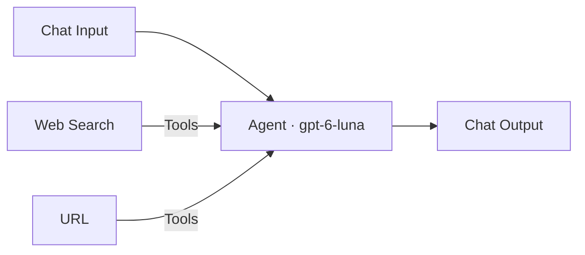

# Aula 08 · Fluxos e agente de pesquisa com Langflow

## Abrir o fluxo de pesquisa

**Pesquisa institucional — TI SEFAZ-MT** é um fluxo do Langflow. No editor, o bloco **Agent** é o componente que usa o modelo e chama as ferramentas **Web Search** e **URL**. O **Playground** é a interface para testar o comportamento desse fluxo.

No Langflow, clique no nome **Pesquisa institucional — TI SEFAZ-MT** na lista do **Starter Project**. A caixa de seleção marca a linha para operações na lista. No editor, clique em **Playground** para enviar uma pergunta. [Abrir o fluxo no servidor local](http://127.0.0.1:7860/flow/bd858c08-f679-4975-b6a6-df336b92641b)

| O que você quer ver | Onde encontrar |
| --- | --- |
| Conversas anteriores | No **Playground**, escolha uma sessão na barra lateral **Sessions**. Nesta instalação, G01 (pergunta direta) está em **New Session 1** e G02 (pergunta vaga) está em **New Session 2**. |
| Histórico de execuções | No editor do fluxo, abra **Traces → Flow Activity** para ver as chamadas, os tokens e a latência. |
| Arquivo do agente | [fluxo04-agente.json](setor-ti-sefaz-mt/fluxo04-agente.json), na pasta `setor-ti-sefaz-mt`. |
| Histórico no Git | O agente entrou no commit `4c79cb8`. Na raiz do repositório, rode `git log --oneline -- aula08/setor-ti-sefaz-mt/fluxo04-agente.json` para ver suas versões. |

O atalho do servidor local abre o fluxo desta instalação. Em outro computador, importe o JSON e abra o fluxo na lista do Langflow.

O Mini LAB usa o atendimento de TI da **SEFAZ-MT** como cenário didático. Ele reúne três fluxos de prompt e um agente que pesquisa fontes públicas. Os testes mostram se cada fluxo cumpriu sua instrução, quantos tokens consumiu e quanto tempo levou. O classificador também é executado pela API para comparar os resultados dos dois caminhos.

O laboratório usa **Langflow 1.12.10** e preserva **`gpt-6-luna`** como modelo OpenAI nos quatro fluxos. O modelo é configurado em **Language Model** nos fluxos de prompt e no bloco **Agent** no fluxo de pesquisa.

[Veja o que caracteriza o agente da aula 08](#o-que-caracteriza-o-agente)

## 1. Instalar e configurar

Dentro de `aula08`, com Python 3.12 ou 3.13 disponível:

```bash
python3.12 -m venv .venv
.venv/bin/python -m pip install -r requirements.txt
umask 077
cp -n .env.example .env
```

Preencha `OPENAI_API_KEY` no `.env` local. Inicie o servidor:

```bash
./iniciar.sh
```

Abra o Langflow em `http://127.0.0.1:7860`. O script carrega o `.env` no terminal e usa um banco SQLite em `.langflow/`. A instalação também foi testada com Python 3.13.

1. Abra o menu do perfil e entre em **Settings → Model Providers → OpenAI**. O cartão deve mostrar o provedor configurado após a leitura de `OPENAI_API_KEY`.
2. Em **Settings → Langflow API Keys**, clique em **Add New**, dê um nome para a chave e selecione **Generate API Key**.
3. Guarde essa segunda chave em `LANGFLOW_API_KEY`, no `.env`. Ela autentica o cliente Python no Langflow. A primeira chave autentica o servidor na OpenAI.

O `.env`, o ambiente virtual e o banco local são ignorados pelo Git. [Instalação do Langflow](https://docs.langflow.org/get-started-installation) · [Chaves e autenticação](https://docs.langflow.org/api-keys-and-authentication)

## 2. Abrir e testar os fluxos

Em **Starter Project**, use o ícone de upload ao lado de **Projects** para importar os JSONs de [setor-ti-sefaz-mt](setor-ti-sefaz-mt). O exemplo da seção 4.3 do material está em [referencias/fluxo01-atendimento-professor.json](referencias/fluxo01-atendimento-professor.json).

Clique no nome do fluxo e depois em **Playground**. Use **+** para abrir uma sessão por caso e registre a resposta, os tokens e o tempo em **Finished in**. Para trocar de fluxo, feche o Playground no **X**, clique em **Starter Project** e escolha o próximo. Também é possível abrir cada fluxo em uma aba do navegador. Cada Playground mostra as sessões do respectivo fluxo.

| Arquivo | O que faz | O que testar |
| --- | --- | --- |
| [Atendimento](setor-ti-sefaz-mt/fluxo01-atendimento.json) | Orienta sobre senha, acesso, restauração, incidentes e chamados. Reconhece lacunas e encaminha assuntos tributários. | A01 a A06. Confira o encaminhamento, a ausência de prazos inventados e o caso de IPVA fora do escopo. |
| [Resumo](setor-ti-sefaz-mt/fluxo02-resumo.json) | Extrai tipo, identificação, data, unidade emissora, impactos e providências com prazo e responsável. | R01. Cole [documento_resumo.txt](documento_resumo.txt) e confira cada linha com o comunicado original. |
| [Classificador](setor-ti-sefaz-mt/fluxo03-classificador.json) | Retorna a categoria na primeira linha e uma justificativa na segunda. | C01 a C05. Teste três categorias e dois casos ambíguos. |
| [Agente de pesquisa](setor-ti-sefaz-mt/fluxo04-agente.json) | Busca e lê páginas públicas para responder com fontes da SEFAZ-MT. | G01 e G02. Compare a chamada direta de URL com a pesquisa seguida de leitura. |

Os textos completos e os critérios de correção estão em [casos.json](casos.json). O comunicado de R01 é uma paráfrase de um documento público real da SEFAZ-MT, com autoria institucional e sem dados pessoais no trecho utilizado. O término da manutenção e o fim da contingência são campos distintos. [Comunicado original](https://www5.sefaz.mt.gov.br/pt/-/sefaz-far%C3%A1-parada-programada-para-manuten%C3%A7%C3%A3o-no-banco-de-dados-1)

### Como montar os três fluxos de prompt

Comece com um fluxo em branco e adicione **Chat Input**, **Prompt Template**, **Language Model** e **Chat Output**. Faça estas ligações:

| Saída | Entrada no destino |
| --- | --- |
| Chat Input | Language Model → `input_value` |
| Prompt Template | Language Model → `system_message` |
| Language Model | Chat Output → `input_value` |

Escreva o escopo, o formato e a orientação para informações desconhecidas no **Prompt Template**. Use a temperatura padrão 1, aceita pelo Luna. Duplique o fluxo e troque o prompt para montar o resumo. O classificador usa a mesma estrutura e adota estas regras:

- **URGENTE** para interrupção generalizada ou sinal concreto de incidente ativo.
- **NORMAL** para pedidos que exigem ação e seguem o atendimento regular.
- **INFORMATIVO** para avisos e agradecimentos sem necessidade de ação.

## 3. Como o agente foi criado

O fluxo **Pesquisa institucional — TI SEFAZ-MT** foi montado no **Starter Project** com o modelo **Simple Agent** incluído no Langflow. Para reproduzir pela interface, siga **New Flow → Browse more → Simple Agent**. Selecione **`gpt-6-luna`** no bloco **Agent**, escreva as instruções em português e mantenha **Web Search** e **URL** ligados à entrada **Tools**. Na configuração deste laboratório, as ferramentas internas de calculadora e data foram desativadas.



### O que caracteriza o agente

O **Agent** interpreta a tarefa, escolhe uma ferramenta, lê o resultado e decide se já tem informação suficiente para responder ou se precisa de outra chamada. Nos três fluxos de prompt, as conexões seguem uma sequência fixa até o **Chat Output**. No fluxo de pesquisa, o modelo decide quais chamadas de ferramenta fazer durante a execução.

| Peça | Configuração na aula 08 |
| --- | --- |
| **Modelo de linguagem** | O `gpt-6-luna` interpreta a pergunta, decide o próximo passo e redige a resposta em português. |
| **Ferramentas** | **Web Search** localiza páginas. **URL** abre a página e devolve o conteúdo para o agente analisar. |
| **Critérios e limites** | A instrução orienta a consultar fontes públicas da SEFAZ-MT, citar apenas as páginas oficiais que conseguiu ler e indicar o que ficou sem verificação. O agente tem limite de oito iterações por execução. |
| **Memória de conversa** | Com o armazenamento habilitado, o agente pode recuperar até 100 mensagens da mesma sessão e do mesmo fluxo. Isso permite perguntas de continuação. Usamos sessões separadas nos dois testes de pesquisa. A memória é opcional, e esses testes demonstram a escolha de ferramentas. |

Os testes mostram essa decisão na prática. Em **G01**, a pergunta trouxe uma URL oficial e o agente usou **URL** diretamente. Em **G02**, a pergunta era vaga e o agente chamou **Web Search**, escolheu uma página institucional e então usou **URL** para ler a fonte antes de responder.

### Como trocar o nome exibido no chat

No editor do fluxo, clique no bloco **Chat Output**. Na barra acima do bloco, abra **Parameters**. Na linha **Sender Name**, clique em **Add** para exibir o campo. Volte ao bloco, substitua **AI** pelo nome desejado e envie uma nova mensagem no Playground para verificar. O nome do fluxo na lista é editado pelo título no topo do editor. Para registrar a alteração no repositório, exporte a versão atualizada em **Share → Export**.

### Como medir o agente

No editor, abra **Traces → Flow Activity**. Observe **Token** e **Latency** e compare com as ferramentas exibidas na resposta no Playground:

| Caso | Ferramentas observadas | Tokens | Latência |
| --- | --- | ---: | ---: |
| G01 · URL oficial fornecida na pergunta | `FETCH CONTENT` | 1.979 | 3,62 s |
| G02 · Pedido geral de ajuda on-line | `PERFORM SEARCH` → `FETCH CONTENT` | 5.581 | 7,99 s |

Na pergunta vaga, buscar antes de abrir a página acrescentou uma chamada e trouxe resultados adicionais para o modelo analisar. As métricas são de uma execução registrada e podem variar em uma nova sessão. [Respostas e medições](resultados/playground.json)

O [desafio opcional](setor-ti-sefaz-mt/desafio-opcional-url-oficial.json) mantém uma única ferramenta, URL, configurada para a Central de Atendimento. Nos dois casos registrados, o agente consultou e citou a mesma página, inclusive quando a pergunta pediu uma fonte externa. [Evidências do desafio](resultados/desafio_opcional.json)

## 4. Exportar e executar pela API

O menu **Share → Export** gera um JSON com os componentes, as ligações e o prompt. Os quatro arquivos do setor estão em [setor-ti-sefaz-mt](setor-ti-sefaz-mt). O identificador de um fluxo pode mudar quando ele é importado em outra instalação. O cliente localiza o classificador pelo nome.

Com o servidor rodando e `LANGFLOW_API_KEY` preenchida, execute dentro de `aula08`:

```bash
.venv/bin/python cliente_api.py listar
.venv/bin/python cliente_api.py comparar resultados/playground.json
```

O comando envia C01 a C05 para `/api/v1/run/<id_do_fluxo>` em sessões independentes. A comparação usa a categoria da primeira linha e a confronta com o gabarito e com a resposta registrada no Playground. `tempo_api_s` inclui a localização do fluxo e a chamada HTTP. As cinco categorias coincidiram nas execuções registradas. [Resultado da API](resultados/comparacao_api.json) · [Documentação do endpoint](https://docs.langflow.org/api-flows-run)

## 5. Resultados dos testes

O [relatório do Mini LAB](resultados/RELATORIO.md) contém 15 execuções, a conferência das datas e responsáveis do resumo e os resultados do agente. A repetição manual do atendimento feita durante o acompanhamento teve estas métricas:

| Caso | Conferência | Tokens | Tempo |
| --- | --- | ---: | ---: |
| P01 · Remoção do professor | Correta. Encaminhou à DRE ou ao RH. | 275 | 2,3 s |
| A01 · Senha de rede | Correta. Orientou a recuperação pelo canal institucional. | 388 | 2,3 s |
| A02 · Permissão de acesso | Parcialmente correta. Pediu os três dados esperados, mas escreveu “teste interno” na primeira frase. | 435 | 3,0 s |
| A03 · Restauração de arquivo | Correta. Pediu o caminho da pasta e a data aproximada. | 403 | 2,3 s |
| A04 · Código de verificação | Correta. Orientou a não compartilhar o código e a acionar a TI. | 423 | 3,0 s |
| A05 · Prazo de chamado | Correta. Orientou a consultar o chamado registrado. | 382 | 2,4 s |
| A06 · IPVA | Correta. Encaminhou ao atendimento tributário. | 384 | 2,3 s |

## 6. Ficha de governança

| Questão | Registro do laboratório |
| --- | --- |
| Para onde vão os textos? | O Langflow local recebe as mensagens e envia entradas e instruções à OpenAI. O agente usa termos de consulta na busca e requisita as páginas abertas com URL. |
| Por quanto tempo ficam no Langflow? | As mensagens com armazenamento habilitado ficam no SQLite local até exclusão. O laboratório não configurou expiração automática de mensagens. |
| Quem revisa as respostas? | Um servidor responsável pelo atendimento de TI deve revisar e aprovar qualquer minuta antes do envio em nome do setor. |
| Onde os prompts são guardados? | Nos JSONs de `aula08/setor-ti-sefaz-mt/`, junto com o grafo de cada fluxo. O Git versiona os arquivos exportados. |
